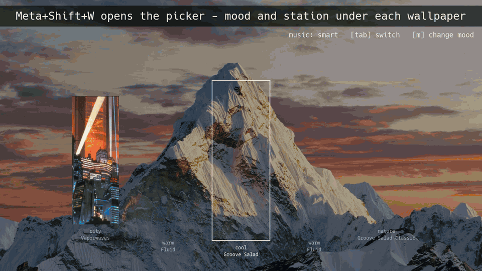

# Wallpaper Picker and music changer



A full-screen cover-flow wallpaper picker for KDE Plasma plays music to match wallpaper, based on color profile of image. Applying a wallpaper also sets:

- the **lock screen** to the same image
- the **accent colour** to the image's main vivid colour
- the **music** to an internet radio station that matches the image's mood

## Install

```bash
git clone https://github.com/cyrix1729/kde-wallpaper-picker ~/dev/kde-wallpaper-picker
~/dev/kde-wallpaper-picker/install.sh            # colour mode only
~/dev/kde-wallpaper-picker/install.sh --smart    # also smart mode (image recognition)
```

`install.sh` symlinks the checkout into `~/.local`, so edits in the repo take effect right away.
It also adds the app-menu entry and the login music autostart. Then bind a shortcut to
"Wallpaper Picker" in System Settings → Keyboard → Shortcuts (here it's Meta+Shift+W).

Needs Plasma 6, PySide6 (`sudo dnf install python3-pyside6`) and VLC (`sudo dnf install vlc`).
`--smart` adds about 200 MB of Python packages in their own folder, plus a ~600 MB model the
first time it runs, and switches you to smart mode.

## Usage

Open it with **Meta+Shift+W**, or launch "Wallpaper Picker" from the app menu, or run `wallpaper-picker` in a terminal.
It opens on your main monitor (the one set as primary in KDE's display settings).

Under each wallpaper you'll see its mood and the music it will play. In the picker:

- **Tab** switches music mode between **colour** and **smart** (shown bottom right).
- **M** changes the selected wallpaper's mood if the guess is wrong. Keep pressing to cycle
  through the moods and back to automatic. It's saved for you.

To add wallpapers, just save images (jpg, png, webp, gif, bmp, avif, jxl) into `~/Pictures/Wallpapers`,
or set `"folder"` in `themes.json` (see below) to use another folder. When the picker opens it
analyses any new images in the background, once each, so there's nothing else to do.

To use a different folder once: `wallpaper-picker ~/some/other/folder`.

### Commands

| Command                          | What it does                                              |
|----------------------------------|-----------------------------------------------------------|
| `wallpaper-picker`               | Open the picker                                           |
| `wallpaper-picker --moods`       | List each wallpaper's mood, how it was chosen and how sure it is |
| `wallpaper-picker --analyse`     | Analyse new wallpapers now (the picker does this itself)  |
| `wallpaper-picker --music-source`| Print what music the current wallpaper plays              |

## How it works

### Accent colour

The image is shrunk to 64×64 and its pixels are grouped by hue, ignoring greys and very
dark pixels. The biggest group, weighted by how vivid it is, wins. Its colour is brightened
and saturated a little so it reads well as an accent, then applied with
`plasma-apply-colorscheme --accent-color`. Anything using the theme highlight colour, like the
Performance Grid widget, follows it. Mostly grey images keep the current accent.
This is the same in both music modes.

### Music mood

Each wallpaper gets one of these moods, and each mood has its own music:

| Mood     | Colour mode: looks like             | Smart mode: pictures like            | Station (SomaFM)     |
|----------|-------------------------------------|--------------------------------------|----------------------|
| `warm`   | orange / red / gold                 | cozy anime scenes, autumn, sunsets   | Fluid (lofi-ish)     |
| `city`   | dark with neon or bright lights     | cities at night, skylines, cyberpunk | Vaporwaves           |
| `space`  | dark blue / purple / magenta        | space, galaxies, starry skies        | Deep Space One       |
| `nature` | green, including dark forests       | forests, mountains, meadows          | Groove Salad Classic |
| `dark`   | dark, any other colour              | gloomy, moody, gothic                | Dark Zone            |
| `cool`   | blue / cyan                         | beaches, ocean, lakes, blue sky      | Groove Salad         |
| `dreamy` | pastel or pink                      | pastel skies, pink clouds            | Lush                 |
| `muted`  | grey / colourless                   | black and white, grey architecture   | Drone Zone           |

There are two ways to pick the mood:

- **Colour mode** (default) reads the same thumbnail: brightness, colourfulness, main hue and
  how many neon or bright-light pixels it has. Fast and needs nothing extra.
- **Smart mode** uses [CLIP](https://openai.com/research/clip), an image-recognition model
  that runs offline on your CPU. Each mood has a few written descriptions (the "pictures like"
  column, editable in `themes.json`). CLIP compares the image with every description and the
  closest mood wins, so a blue-tinted anime street still comes out as lofi. If it's less than
  50% sure, it uses the colour mood instead, shown as e.g. `cool (colour)` in the picker.

Results are cached in `~/.cache/wallpaper-picker/`. Each image is analysed once; editing the
descriptions only re-runs the quick text side, and changing an image's file re-analyses it.

When you apply a wallpaper, the music switches after the picker closes. If the station is the
same it leaves the music alone, and if you stopped the music it stays off. Setting a wallpaper
through KDE's own settings won't change the music until the next login.

### Where the music comes from

The first match wins:

1. a `music` entry for that wallpaper in `themes.json`
2. songs in `~/Music/Wallpapers/<wallpaper name without extension>/`
3. songs in `~/Music/Moods/<mood>/`
4. the mood's radio station

The `~/Music/Moods/*` folders start empty, so by default it's all radio.
Radio plays indefinitely. Folders are shuffled and looped.

## Customising: `~/.config/wallpaper-picker/themes.json`

The file is created with the defaults on first run. Entries are keyed by wallpaper file name:

```json
{
  "folder": "~/Desktop/wallpapers",
  "mode": "smart",
  "default": { "accent": "auto" },
  "moods": {
    "warm": {
      "music": "https://ice1.somafm.com/fluid-128-mp3",
      "prompts": ["a cozy anime scene", "autumn leaves", "a warm golden sunset"]
    },
    "...": "..."
  },
  "Autumn.jpg":  { "accent": "#e9643a" },
  "Kokkini.png": { "mood": "city" },
  "Path.jpg":    { "music": "https://ice1.somafm.com/groovesalad-128-mp3" }
}
```

- `folder`: where wallpapers are listed from (default `~/Pictures/Wallpapers`)
- `mode`: `"colour"` or `"smart"` (Tab in the picker changes this)
- `moods`: each mood's `music` and, for smart mode, its `prompts`: short descriptions of
  images that fit it. Add a description when something lands in the wrong mood, or add a whole
  new mood with its own prompts and station. Other SomaFM stations are listed at somafm.com.
- per wallpaper:
  - `accent`: `"auto"` (from the image) or any colour like `"#e9643a"`
  - `mood`: force a mood instead of guessing (M in the picker sets this)
  - `music`: a stream URL, an audio file, or a folder

Changes take effect the next time you open the picker or apply a wallpaper.

## Files

| Path                                                   | Purpose                                        |
|--------------------------------------------------------|------------------------------------------------|
| `~/.local/bin/wallpaper-picker`                        | Python backend: apply, accent, mood, music     |
| `~/.local/share/wallpaper-picker/picker.qml`           | The cover-flow UI                              |
| `~/.local/share/applications/wallpaper-picker.desktop` | App-menu entry (bind your shortcut to it)      |
| `~/.local/bin/boot-music.sh`                           | Plays the music (at login and on switches)     |
| `~/.config/autostart/` (Boot Music entry)              | Runs `boot-music.sh` at login                  |
| `~/.config/wallpaper-picker/themes.json`               | Your settings and overrides                    |
| `~/.cache/wallpaper-picker/music-source`               | What's playing now, so it isn't restarted      |
| `~/.cache/wallpaper-picker/moods.json`                 | Each image's colour and smart mood             |
| `~/.cache/wallpaper-picker/clip-embeddings.json`, `models/` | Smart mode's image analysis and CLIP model |
| `~/.local/share/wallpaper-picker-smart/`               | Smart mode's Python environment (`--smart`)    |
| `smart/classify.py` (in the repo)                      | Smart mode's CLIP matching                     |
| `~/Pictures/Wallpapers/` (or `folder`)                 | Wallpaper images                               |
| `~/Music/Moods/<mood>/`, `~/Music/Wallpapers/<name>/`  | Optional local music                           |

The installed paths are symlinks into this repo, except the two `.desktop` files, which `install.sh`
generates from the templates here.

## Boot splash (separate)

An ASCII-art boot screen theme, `sphinx-ascii`, lives in `~/.local/share/plymouth-sphinx/`.
It isn't linked to the picker, and its orange colour is fixed when it's built.

- Install: `sudo ~/.local/share/plymouth-sphinx/install.sh`
- Change the art or text: edit `build-theme.py`, run it, then install again
- Undo: `sudo plymouth-set-default-theme bgrt -R`
